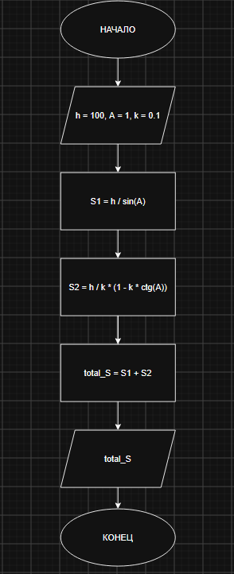

# Домашнее задание к работе 2

## Условие задачи
Определить путь, который проедут санки с горки высотой h метров, углом наклона А
радиан и коэффициентом трения k.

## 1. Алгоритм и блок-схема

### Алгоритм
1. **Начало**
2. Задать исходные данные и конкретные значения:
   - 'h' = 100 - высота горки в метрах.
   - 'A' = 1 - угол наклона горки в радианах.
   - 'k' = 0.1 - коэффициент трения.
3. Вичислить путь по склону:
   - 'S1' = 'h' / 'sin(A)'
4. Вычислить путь после горки:
   - 'S2' = 'h' / 'k' * (1 - 'k' * ('ctg(A)'))
5. Вычислить весь путь:
   - 'total_S' = 'S1' + 'S2'
6. Вывести результаты расчетов с подстановкой всех значений в текст.
7. **Конец**

### Блок-схема


 [https://app.diagrams.net/#LSCHEMA_lab2.drawio#%7B%22pageId%22%3A%229VRjgDKYlaXdKA0vQ1g_%22%7D](# "как SCHEMA.png")

## 2. Реализация программы


```
#include <stdio.h>
#include <locale.h>
#include <math.h>

int main() {
	setlocale(LC_CTYPE, "RUS");

	//задание конкретных значений переменных
	int h = 100;
	int A = 1;
	float k = 0.1f;

	//вычисление пути по склону
	float S1 = h / sin(A);

	//вычисление пути после горки
	float S2 = h / k * (1 - k * (cos(A) / sin(A)));

	//вычисление всего пути
	float total_S = S1 + S2;

	printf("РАСЧЕТ ПУТИ, ПРОЙДЕННОГО САНКАМИ\n");
	printf("================================\n\n");
	printf("УСЛОВИЯ:\n");
	printf("- Высота горки: %d метров.\n", h);
	printf("- Угол наклона: %d радиан.\n", A);
	printf("- Коэффициент трения: %.2f.\n\n",k);
	printf("РАСЧЕТЫ:\n");
	printf("- Путь по склону: %d / sin(%d) = %.2f метров.\n", h, A, S1);
	printf("- Путь после горки: %d / %.2f * (1 - %.2f * ctg(%d)) =  %.2f метров.\n", h, k, k, A, S2);
	printf("================================\n");
	printf("ОБЩИЙ ПУТЬ: %.2f МЕТРОВ.", total_S);

	return 0;
}
```

## 3. Результаты работы программы

```
РАСЧЕТ ПУТИ, ПРОЙДЕННОГО САНКАМИ
================================

УСЛОВИЯ:
- Высота горки: 100 метров.
- Угол наклона: 1 радиан.
- Коэффициент трения: 0.10.

РАСЧЕТЫ:
- Путь по склону: 100 / sin(1) = 118.84 метров.
- Путь после горки: 100 / 0.10 * (1 - 0.10 * ctg(1)) =  935.79 метров.
================================
ОБЩИЙ ПУТЬ: 1054.63 МЕТРОВ.
```

## 4. Информация о разработчике

Лупачев Сергей бТИИ-262